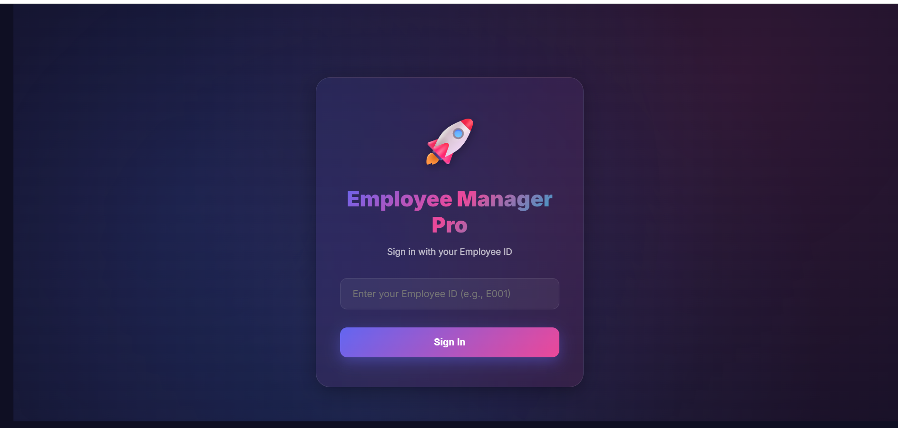
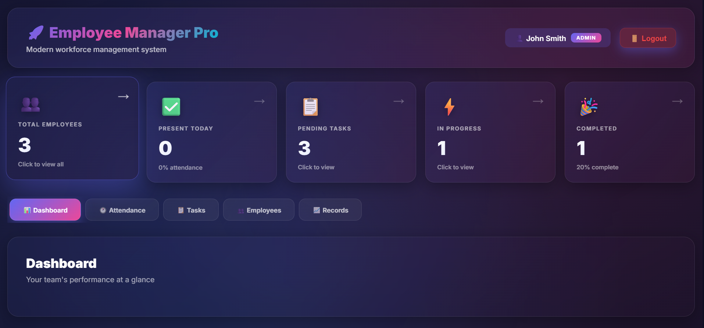
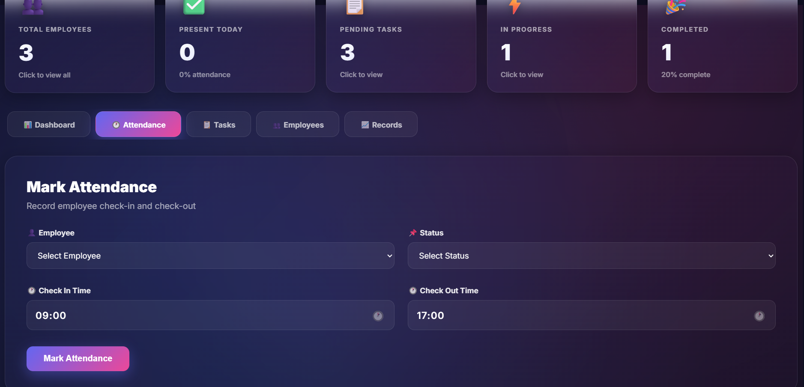
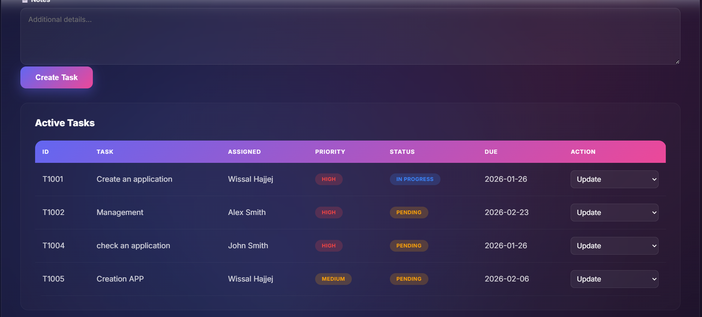

# Employee Task & Attendance Manager

Attendance and task tracker with login and roles, built with Google Apps Script and Google Sheets

## Screenshots

## Features

- Login with Employee ID, with Admin and User roles
- Attendance: check in and check out
- Tasks: create, assign and update
- Reports and dashboard

## Technologies

Google Apps Script (JavaScript) | HTML | CSS | Google Sheets (used as the database)

## Project structure

- `apps-script/Code.gs`: server-side logic (login, attendance, tasks, reports)
- `apps-script/index.html`: main interface of the web app
- `apps-script/*Dialog.html`: dialogs for attendance, tasks, task updates and reports

## How to run

1. Create a Google Sheet with the sheets `Employees`, `Attendance`, `Tasks` and `Dashboard`. The `Employees` sheet has the columns Employee ID, Name, Email, Department, Position, Status, Role.
2. In the sheet, open Extensions > Apps Script and copy the files from `apps-script/` into the project.
3. Click Deploy > New deployment > Web app, then open the link.

## Limitations

The login uses the Employee ID only, without a password. It is a demo; a real deployment would add password authentication.

## Author

Wissal Hajjej, Computer Engineering student at Girne American University (graduating June 2027)
